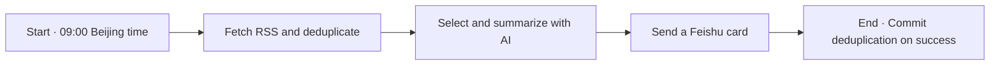
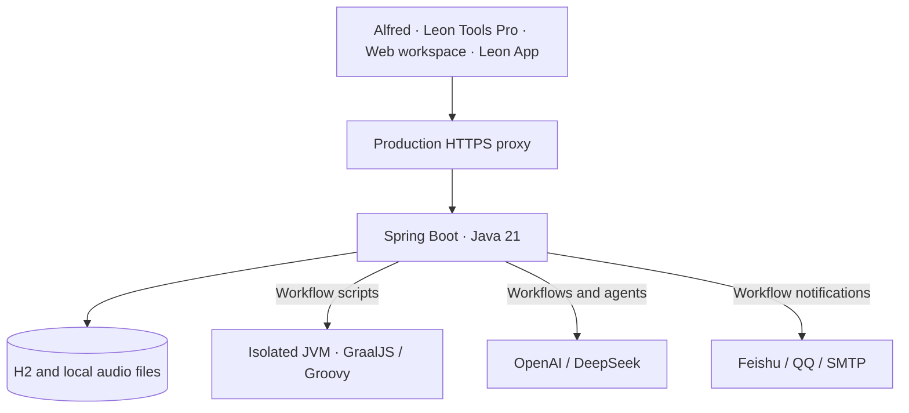

# Leon Lite Workflow

[简体中文](README.md)

Leon Lite Workflow is a self-hosted backend shared by Alfred, Leon Tools Pro, and Leon App. Its web workspace lets you manage personal data, build and publish workflows, and inspect individual runs. The related **Leon Workflow** project is a local workflow and developer workbench.

[Quickstart](#quickstart) · [Features](#features) · [Automation example](#automation-example) · [Architecture](#architecture) · [Configuration and operations](#configuration-and-operations)

## Quickstart

You need **JDK 21** and **Maven**. From the repository root, check that Maven reports Java 21 and start the service. On macOS, you can select the JDK with `export JAVA_HOME=$(/usr/libexec/java_home -v 21)`.

```bash
mvn -version
mvn spring-boot:run
```

After startup, open the [web workspace](http://127.0.0.1:8080/) or verify the health and Alfred endpoints from a second terminal.

```bash
curl --noproxy 127.0.0.1 -fsS http://127.0.0.1:8080/hello
curl --noproxy 127.0.0.1 -fsS http://127.0.0.1:8080/alfred/query \
  -H 'Content-Type: application/json' \
  -d '{"param":"1+2"}'
```

The health check returns `你好` (hello). The Alfred endpoint returns a JSON array containing the result `3`.

**Run your first workflow**

1. Open **工作流编排** (Workflows), choose **新建工作流** (New workflow), and name it `Quickstart`. Keep the default Start → End connection.
2. Choose **发布版本** (Publish version), enter the JSON below in **手动运行 / 调试输入** (Manual run input), and click **运行 v1** (Run v1).
3. Open **运行实例** (Runs), find the successful run, and inspect the End node. Its output should match the input.

```json
{"items":[{"json":{"message":"hello"}}]}
```

This example uses only built-in nodes and requires no model keys, bot credentials, or script sandbox. The development server listens on `127.0.0.1:8080` by default. Use the unauthenticated setup on a trusted local machine. H2 initializes its tables on first launch and stores data in `data/leon-workflow.mv.db` relative to the working directory. Stop the service before copying the data directory for backup.

## Features

| Entry point | What you can do |
| --- | --- |
| Alfred | Search bookmarks and shortcuts, calculate, translate, convert timestamps, and save JSON from the keyboard. Enter `help` for the command list. |
| Leon Tools Pro | Capture bookmarks, sticky notes, and tasks in Chrome, then organize them in the web workspace. |
| Web workspace | Connect HTTP, RSS, GitHub Trending, AI summaries, JavaScript, Groovy, and conditional branches in the workflow editor. Publish and run manually or on a schedule, then inspect node results. |
| Leon App | Chat privately or in groups with OpenAI or DeepSeek agents on macOS, Android, and iOS. Conversations support context compaction and history search. The Mac client can archive summaries and transcripts to LeonBook. |
| 声屿 music library | Upload audio and manage online playlists in the workspace. Clients sync playlists and can play cached tracks offline. |

A separate [Android admin client](android/README.md) provides mobile access to the same web workspace. The existing Alfred and extension integrations use the compatible `/alfred/query` and `/api` endpoints.

## Automation example

The **RSS tech news digest** runs the latest published version at 09:00 Beijing time after you configure a model and Feishu bot and enable the schedule. It reads seven feeds, filters for new entries, picks up to ten articles for detailed summaries, and adds brief notes for the remaining entries. The Feishu card includes links to the original articles.



With no new entries, the summary node skips the model call and the Feishu node skips delivery. Use the Runs page to see which node failed and read its logs. See the [example definition](scripts/create_rss_workflow.py) and the [workflow reference in Chinese](README.md#工作流编排一期).

## Architecture



- **Access and authentication.** Alfred and the Chrome extension send a Bearer token. With authentication enabled, workflow management uses a secure browser session cookie and checks the origin of write requests.
- **Execution and integrations.** Workflows are directed acyclic graphs. Nodes exchange JSON items and independent branches can run in parallel. Schedules use the latest published version, skip a trigger if a run is queued or active, and resume with the next scheduled time after downtime. Workflow credentials use AES-256-GCM encryption.
- **Storage and operations.** H2 stores application data, conversations, workflow versions, and run records. Audio files live on the server filesystem. Production runs on Alibaba Cloud ECS under systemd. Releases verify the package, take backups, restart the service, and check the result. A failed verification rolls back the application package.

## Configuration and operations

| Environment variable | Purpose |
| --- | --- |
| `LEON_DB_URL` | Override the H2 JDBC URL. The default is `jdbc:h2:file:./data/leon-workflow`. |
| `LEON_DB_PASSWORD` | Set the password for the H2 `sa` user. File encryption requires separate configuration. |
| `LEON_AUTH_TOKEN_SHA256` | Enable service access-token authentication with a 64-character hexadecimal SHA-256 hash. |
| `LEON_AUTH_REQUIRED` | Set to `true` to require a valid token hash at startup. |
| `LEON_AUTH_ADMIN_ORIGIN` | Set the exact allowed origin for management writes. |
| `LEON_ALFRED_API_KEY` | Enable the legacy Alfred request signature in addition to service authentication. |
| `LEON_WORKFLOW_CREDENTIAL_KEY` | Encrypt saved workflow credentials with a Base64-encoded 32-byte key. Preserve the same key across upgrades. |
| `LEON_WORKFLOW_SCHEDULING_ENABLED` | Enable workflow scheduling, on by default. |
| `LEON_PLUGIN_DIGEST_SCHEDULING_ENABLED` | Enable plugin to-do statistics and daily summaries, off by default. |
| `YOUDAO_APP_KEY` / `YOUDAO_APP_SECRET` | Enable Youdao translation for the Alfred `fy` command. |
| `LEON_MUSIC_DIRECTORY` | Set the audio storage directory. The default is `./data/music`. |

For remote access, configure HTTPS, token authentication, and the management origin before exposing the service. The web login issues a `Secure`, `HttpOnly` session cookie. Management writes require the configured origin and `X-Requested-With: XMLHttpRequest`. Keep tokens and encryption keys in private server configuration.

Preserve existing plugin IDs when migrating data. Cached extension records use those IDs, so verify the migration before pointing an existing extension at a new H2 database. See the [migration procedure in Chinese](README.md#数据迁移).

| Reference | Details |
| --- | --- |
| [Management workspace](README.md#管理页面) | Workspace routes, monitoring, deployment history, backup retention, and rollback |
| [Alfred protocol](README.md#alfred) | Request signing, shortcuts, and the command list |
| [Plugin API](README.md#插件接口) | Compatibility and optional statistics and daily summaries |
| [Workflows](README.md#工作流编排一期) | Nodes, scheduling, credential configuration, and execution details |
| [Agents and messaging](README.md#leon-消息客户端与-agent-工作台) | Model configuration, conversation behavior, and LeonBook archiving |
| [Music library](README.md#声屿在线歌曲) | Track upload, playlists, and client synchronization |

### Build and test

Run these commands from the repository root with Java 21.

```bash
mvn test
mvn package
```

See the [verification reference in Chinese](README.md#检查) for browser regression tests and their environment variables.
